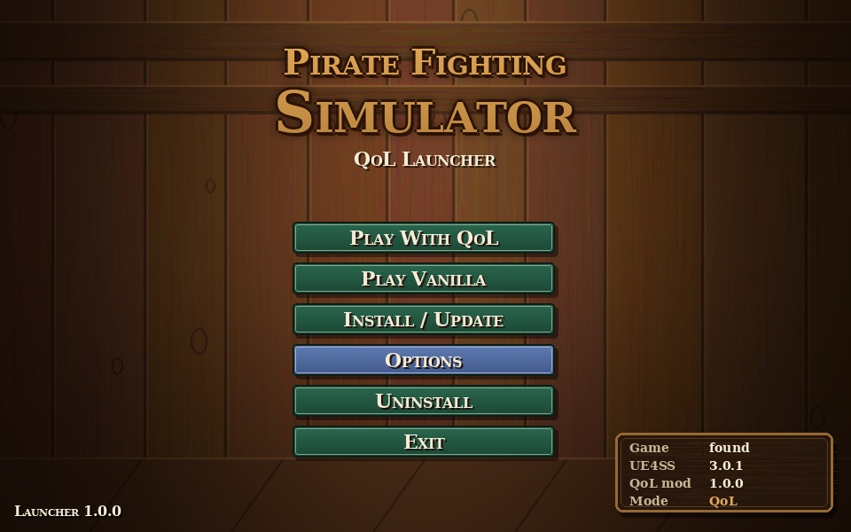
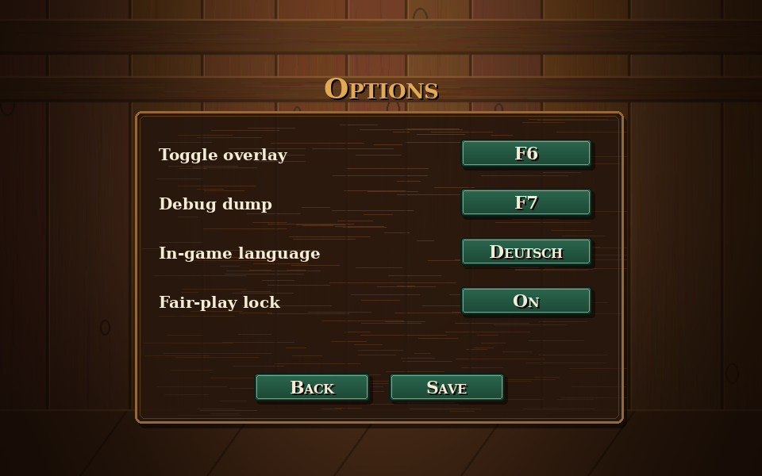
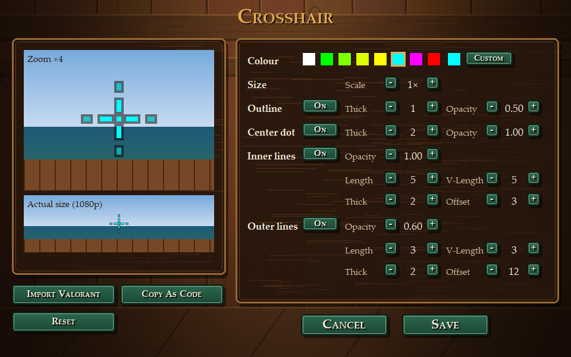

# Pirate Fighting Simulator – QoL

Quality-of-life overlay for **private lobbies** in [Pirate Fighting Simulator](https://store.steampowered.com/app/2186400/Pirate_Fighting_Simulator/), built as a [UE4SS](https://github.com/UE4SS-RE/RE-UE4SS) Lua mod – plus a small launcher that installs everything and lets you start the game with QoL or completely vanilla.

> **Fair play first:** by default the overlay only turns on when **every** player in the lobby (host included) runs it. Join a random lobby and it stays off.

<p align="center">
  
</p>

---

## Features

| Feature | What it does |
|---|---|
| **Crosshair** | Fully customisable crosshair (the game has none) – lines, outline, centre dot, colours. **Import your VALORANT crosshair code.** |
| **HP as a number** | `HP 73 / 100` instead of just a bar – turns yellow / red when low. |
| **Kill feed with details** | `Pedi > Blitzbube4   25 m   (75 HP left) · ended a 4 streak · 2 bananas` |
| **Death notice** | When *you* die: who killed you, how much HP they had left and from how far away. |
| **Victim stats** | The kill streak the victim had and how many bananas (heals) they ate in that life. |
| **Fair-play lock** | Only active if everybody in the lobby uses the helper (see below). |
| **Languages** | In-game texts in German or English. |

## Installation

### Option A – Launcher (recommended)

1. Download **`PFS-QoL-Launcher.exe`** from the [latest release](../../releases/latest).
2. Start it. It finds the game through Steam automatically (or press *Locate Game*).
3. Click **Install QoL**. The launcher downloads UE4SS 3.0.1 from its official GitHub release and installs the mod.
4. Click **Play with QoL** – or **Play Vanilla** for an untouched game.

> If the game lives in `C:\Program Files (x86)\…`, Windows protects that folder. The launcher then offers to restart itself as administrator.
>
> The mode you picked last stays active when you start the game directly from Steam.

### Option B – Manual

1. Download `UE4SS_v3.0.1.zip` from the [UE4SS releases](https://github.com/UE4SS-RE/RE-UE4SS/releases/tag/v3.0.1) and extract it into
   `…\steamapps\common\Pirate Fighting Simulator\PirateFS\Binaries\Win64\`
   (so that `dwmapi.dll` sits next to `PirateFS-Win64-Shipping.exe`).
2. Download **`PFS_QoL-mod.zip`** from the [latest release](../../releases/latest) and copy the `PFS_QoL` folder into `Win64\Mods\`.
3. Recommended: set `CheatManagerEnablerMod`, `ConsoleEnablerMod` and `ConsoleCommandsMod` to `0` in `Win64\Mods\mods.txt` (the launcher does this for you).
4. Start the game normally.

**Uninstall:** use the launcher, or delete `dwmapi.dll` from the `Win64` folder.

## Usage

| Key (default) | Action |
|---|---|
| `F6` | Show / hide the overlay |
| `F7` | Write a debug dump into `Win64\UE4SS.log` |

Both keys can be changed in the launcher (**Options**) – handy for keyboards without F-keys. All other settings live in `Win64\Mods\PFS_QoL\Scripts\config.lua`.

The status line in the top-left corner shows whether QoL is active (`QoL active 2/2`) or which players are missing the helper.

<p align="center">
  
</p>

## Crosshair editor

**Launcher › Options › Crosshair › Edit** opens the editor with a zoomed and an actual-size preview.

- Colour (VALORANT's presets or any hex colour), size, outline, centre dot, inner and outer lines (length, separate vertical length, thickness, offset, opacity)
- **Import Valorant** – in VALORANT go to *Settings › Crosshair › Primary › Export Profile Code*, then paste the code (e.g. `0;P;c;5;h;0;0l;4;0o;2;0a;1;0f;0;1b;0`). Values the code leaves out use VALORANT's defaults, just like in the game.
- **Copy as Code** – exports your crosshair as a VALORANT code.
- Sizes are pixels at 1080p and scale with the resolution, like in VALORANT. Dynamic parts (movement/firing error) are ignored.

The crosshair is only shown while you are alive (not in menus or on the spawn screen).

<p align="center">
  
</p>

## The fair-play lock

The helper appends ` [QoL]` to your player name. Every helper checks the names of all players in the lobby and only switches on when **all** of them carry the tag. If someone without the helper joins, the overlay turns off for everyone.

You can disable the lock in the launcher options (a warning explains why). Without it, crosshair, exact HP and kill info work in any lobby and give you an **unfair advantage** over players who don't have them – only do that for testing or when everybody agrees.

The installer also disables the UE4SS example mods that unlock the developer console and the cheat manager.

## How it works

- **UE4SS** loads Lua scripts into the game. The mod reads the game's own Blueprint variables (`Current Health`, `Kills`, `Deaths`, `Killer`, …) and draws its overlay with UMG widgets.
- Pirate Fighting Simulator uses a **listen server**: the host knows everybody's real HP, clients don't. When someone dies, the host's helper writes the killer, the killer's remaining HP and the victim's banana count into two replicated `PlayerState` fields the game does not use (`Score`, `StartTime`). Clients read them from there – so every player sees the same information, at the same time, and only after a kill.
- Clients read their own HP from the game's own health bar, so nobody gets information the game doesn't already show them.

## FAQ

**Is this a cheat?** It is meant for private lobbies with friends who all use it, and it enforces that by default. It shows nothing about other players while they are alive.

**My antivirus complains about the .exe.** The launcher is built with PyInstaller, which some scanners flag by mistake. The source is in [`launcher/`](launcher/) and the exe is built by GitHub Actions ([workflow](.github/workflows/release.yml)). You can also run it from source (see below) or use the manual installation.

**The game got an update and the mod stopped working.** Open an issue and attach your `Win64\UE4SS.log` (press `F7` in game first).

## Building from source

```bash
cd launcher
pip install -r requirements.txt
python pfs_qol_launcher.py                 # run the launcher
pip install pyinstaller                     # build the exe (Windows)
pyinstaller --onefile --windowed --name PFS-QoL-Launcher --add-data "../mod/PFS_QoL;PFS_QoL" pfs_qol_launcher.py
```

Pushing a tag like `v1.0.0` – or running the *Build & Release* workflow manually with a tag – builds the exe and publishes a release.

## Project layout

```
mod/PFS_QoL/          UE4SS Lua mod (main.lua, config.lua)
launcher/             Python launcher (Tkinter + Pillow)
  core.py             Steam detection, install, mode switch, settings
  crosshair.py        crosshair model, VALORANT code import/export, geometry
  theme.py            procedurally drawn artwork in the game's style
  pfs_qol_launcher.py GUI
.github/workflows/    build & release
```

## Credits & license

- Made by [BlwLeon](https://github.com/BlwLeon) and friends.
- [RE-UE4SS](https://github.com/UE4SS-RE/RE-UE4SS) (MIT) – the scripting system this mod runs on. It is downloaded from its official release, not redistributed here.
- Not affiliated with Uncommon UTD, the developers of Pirate Fighting Simulator. No game assets are included; the launcher artwork is drawn in code.

Released under the [MIT License](LICENSE).
